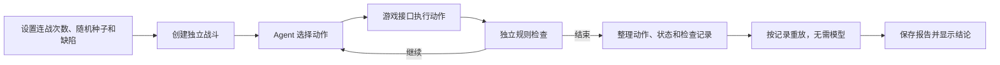
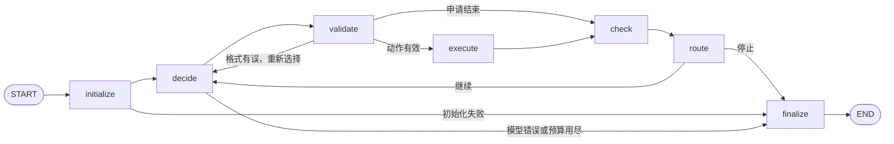
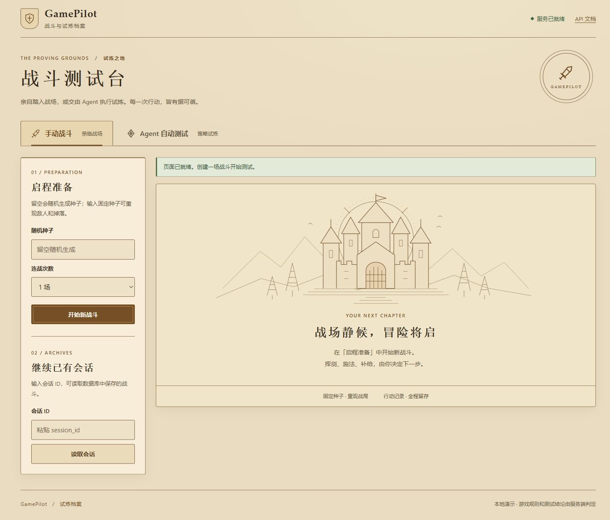
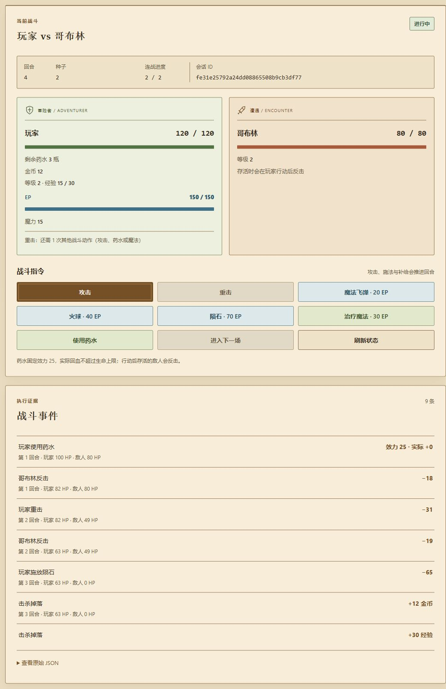
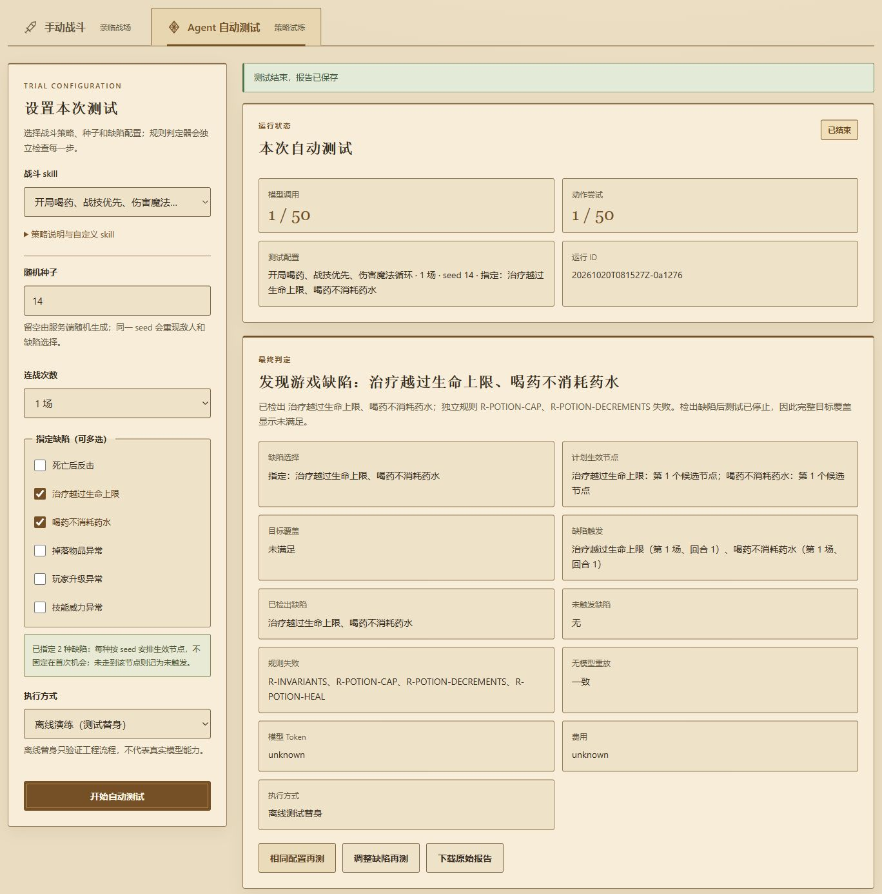
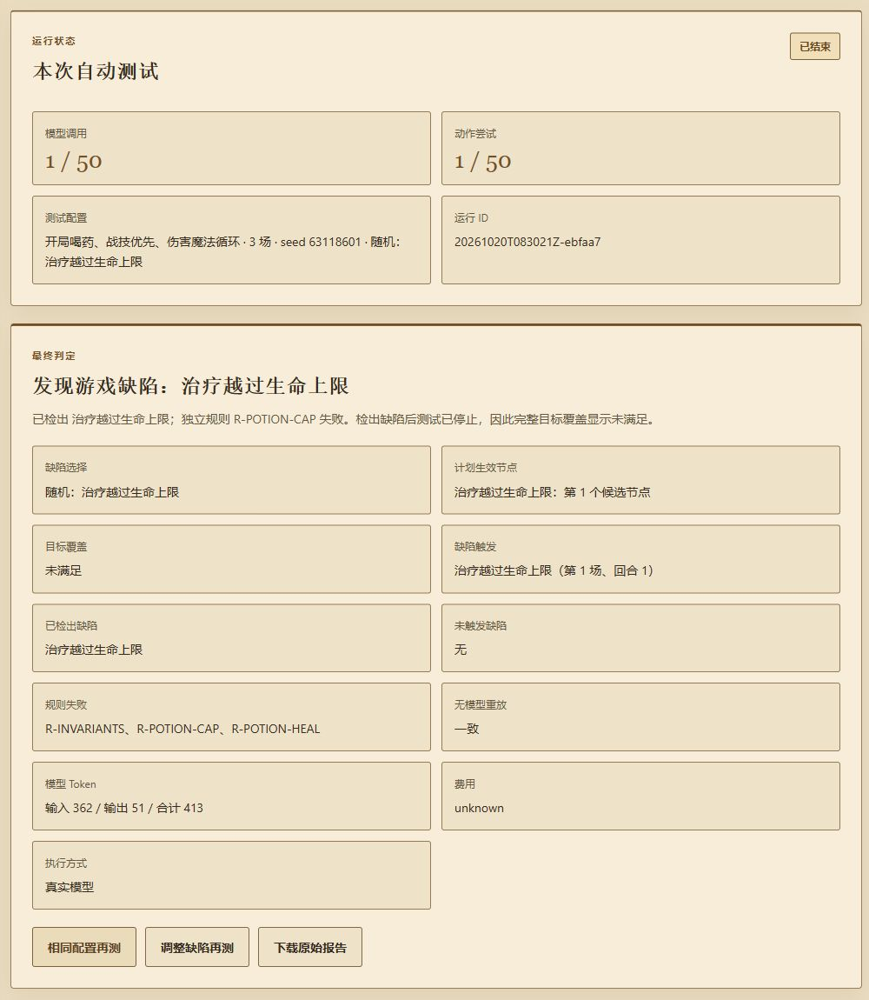
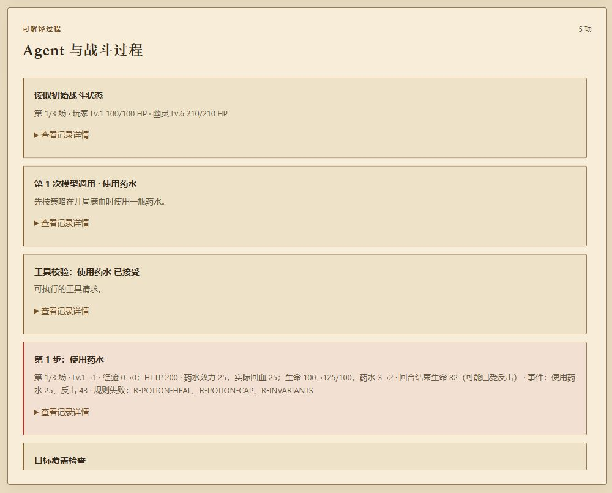

# GamePilot

## 项目简介

GamePilot 是我基于个人学习研究和兴趣制作的游戏测试平台。目前它用一个可重复的回合制战斗，练习让 Agent 自己选择测试动作、发现规则异常，并留下可以复查的过程记录。项目仍在开发中，现阶段只覆盖内置战斗场景。

**产品定位**

- 一个可以手动玩、也可以交给 Agent 自动测试的小型战斗环境。
- 同一随机种子配合同一组动作，可以重现敌人、战斗过程和测试结果。

**核心能力**

- 支持 1～6 场连战和八种敌人。击败敌人会获得经验；新会话每级经验门槛依次为 15、30、45……，升级提高伤害、生命、EP 上限和魔力。
- 玩家可使用有冷却的重击，以及只受 EP 限制的三种伤害魔法和一种治疗魔法。
- 可以指定已知缺陷，也可以让系统按随机种子决定是否安排缺陷。缺陷会在预定的有效机会出现，不固定在第一次。
- Agent 负责选择攻击、战技、魔法、喝药或进入下一场；独立的规则检查程序负责判断结果是否正确。
- 保存动作、状态、规则检查和报告，并用记录下来的动作重新运行一次，核对结果能否复现。

**典型场景**

- 手动打一场或多场，观察生命值、经验、升级和掉落是否符合预期。
- 开启离线自动测试，看 Agent 如何一步步操作并查看每步的检查结果。
- 指定一种缺陷，再用相同种子重测，确认异常是否出现在相同位置、判定是否一致。

## Agent 工作机制

### 平台测试流程



测试开始时，平台先确定敌人和缺陷安排。每执行一步，规则检查程序都会根据动作前的状态计算预期，再与游戏返回的状态比较。Agent 即使认为“测试通过”，也不能替代这一步检查。测试结束后，平台会区分游戏规则错误、Agent 没发现已出现的缺陷、缺陷未触发、目标未完成和执行错误。

### Agent 内部的 LangGraph 工作流

下面的英文名称与代码中的节点一致。箭头表示下一步要去哪里，`route` 会决定继续测试还是收尾。



| 节点 | 做什么 |
| --- | --- |
| `initialize` | 创建战斗会话，读取初始状态。 |
| `decide` | 读取当前状态和测试策略，取得下一步动作；真实模式在这里调用模型。 |
| `validate` | 检查动作是否在允许范围内、参数是否正确。无效动作不会发给游戏。 |
| `execute` | 调用游戏接口执行动作，比较预期和实际结果，并记录这一步。 |
| `check` | 根据已执行的步骤，检查测试目标是否已经覆盖。 |
| `route` | 根据检查结果、目标和步数预算，决定继续或结束。 |
| `finalize` | 整理本次测试的记录和停止原因。 |

离线演练也走这张图，在 `decide` 节点使用固定的测试策略。它用于验证流程；真实模型的表现需要单独测试。真实模式需要配置密钥，并在页面确认后才会调用模型。

## 产品截图

以下展示当前羊皮纸风格界面与主要功能，点击图片可查看原图。自动测试截图使用 2026-10-20 保存的 v5 运行记录，通过当前页面渲染；离线替身与真实模型结果分别标注。

### 初始主界面

手动战斗与 Agent 自动测试共用入口。支持固定随机种子、1～6 场连战，以及通过会话 ID 继续已有战斗。

[](docs/images/platform-home.jpg)

### 手动战斗

查看双方生命、EP、等级、经验与补给，选择攻击、重击、魔法或药水。图中为 seed 2 的第二场连战：玩家已升级，重击仍在冷却，事件列表保留了药水、反击、魔法和掉落记录。

[](docs/images/manual-battle.jpg)

### 离线自动测试结果

seed 14 同时指定“治疗越过生命上限”和“喝药不消耗药水”，两项缺陷均被独立规则检出，无模型重放一致。页面展示生效节点、触发位置、失败规则及报告入口；离线替身用于验证工程流程，不代表真实模型能力。

[](docs/images/agent-offline-result.jpg)

### 真实模型结果与执行过程

`deepseek-v4-flash` 在 seed 63118601 的一次运行中，通过开局喝药触发并检出“治疗越过生命上限”，随后停止测试，无模型重放一致。实际调用 1 次，输入 362 / 输出 51 Token，合计 413；费用为 `unknown`。这是单次缺陷检出样例，未完成配置中的 3 场连战，不代表完整测试矩阵通过。

[](docs/images/agent-real-result.jpg)

过程面板保留模型选择、工具校验、动作前后状态和规则失败证据，可继续展开查看记录详情。

[](docs/images/agent-real-process.jpg)

## 技术栈

| 部分 | 技术 | 用途 |
| --- | --- | --- |
| 后端接口 | Python 3.12+、FastAPI、Uvicorn | 提供游戏和自动测试接口。 |
| Agent | LangGraph、Anthropic 兼容接口 | 编排测试步骤；可选用 DeepSeek 模型。 |
| 战斗与判定 | Python、Pydantic | 管理战斗状态，按规则检查测试结果。 |
| 页面 | HTML、CSS、JavaScript | 手动战斗、启动自动测试、查看过程和报告。 |
| 数据存储 | PostgreSQL、SQLAlchemy、Alembic | 保存战斗与测试记录，管理数据库迁移。 |
| 本地交付与检查 | Docker Compose、pytest、Ruff | 启动服务，运行测试和代码检查。 |

## 快速启动

### 给体验者：用 Docker 启动

准备好 Git 和 Docker Engine（含 Docker Compose v2）。目前提供的是本地运行方式：需要先把仓库克隆到自己的电脑，也可以在 GitHub 下载 ZIP 后解压；不需要另外安装 Python。

```powershell
git clone https://github.com/b1700258141-lgtm/GamePilot-Agent-.git
cd GamePilot-Agent-
docker compose -f compose.local.yaml up --build
```

首次构建会下载镜像和 Python 依赖，可能需要等待。终端保持打开，服务就绪后访问 [http://127.0.0.1:8000/](http://127.0.0.1:8000/)；接口文档在 [http://127.0.0.1:8000/docs](http://127.0.0.1:8000/docs)。进入“Agent 自动测试”，选择 1～6 场连战和“离线演练”，即可在不配置模型密钥的情况下体验完整流程。战斗和测试记录保存在本地 PostgreSQL 卷中，停止容器不会删除它们。

这个地址只在运行项目的电脑上可用。面向其他人直接访问的公网网页，需要后续完成云平台部署，届时会补充部署方法。更多本地启动细节见 [Docker 说明](docs/DOCKER.md)。

### 给开发者：本地运行 Python

安装 Python 3.12+，在仓库根目录执行以下命令（Windows PowerShell）：

```powershell
python -m venv .venv
.\.venv\Scripts\python.exe -m pip install -e ".[dev,agent]"
.\.venv\Scripts\python.exe -m uvicorn gamepilot.main:app --reload
```

访问同一个本地地址即可。未配置 `.env` 时使用内存存储，不需要 PostgreSQL，但进程结束后记录不会保留。需要数据库持久化时，使用上面的 Docker 方式，或按 [Docker 说明](docs/DOCKER.md)配置 PostgreSQL。

## 配置说明与常用命令

Docker 的离线演练无需额外配置。本地 Python 开发可参考 [`.env.example`](.env.example)；常用配置如下：

| 配置项 | 作用 |
| --- | --- |
| `REPOSITORY_BACKEND` | `memory` 为默认内存存储；`postgres` 使用 PostgreSQL。Docker 本地编排已配置为 `postgres`。 |
| `DATABASE_URL` | 本地 Python 选择 `postgres` 时填写数据库连接地址。Docker 本地编排已设置。 |
| `GAMEPILOT_AGENT_API_KEY` | 选择真实模型时由服务端读取的密钥；填入本地 `.env` 后，Docker Compose 后续启动会自动传入。`.env` 已被 Git 忽略。 |
| `GAMEPILOT_API_PORT` | Docker 页面映射到本机的端口，默认 `8000`。 |

若不想把密钥保存在本地 `.env`，Windows 下仍可运行 `.\scripts\start_local_with_model.ps1` 临时转发本机已有的 DeepSeek 密钥；首次需要构建时加 `-Build`。真实模式最多进行 50 次模型调用和 50 次动作，输入 Token 与费用没有硬上限，请在页面确认后再运行。

在仓库根目录常用以下命令：

```powershell
# 查看本地服务状态和日志
docker compose -f compose.local.yaml ps
docker compose -f compose.local.yaml logs --tail 80 api

# 停止本地服务；保留数据库卷
docker compose -f compose.local.yaml stop

# 运行非数据库测试和代码检查（先完成上面的 Python 依赖安装）
.\.venv\Scripts\python.exe -m pytest -q -p no:cacheprovider -m "not postgres"
.\.venv\Scripts\python.exe -m ruff check .
.\.venv\Scripts\python.exe -m ruff format --check .
```

数据库测试需要单独的测试库；具体方法见 [CI 说明](docs/CI.md)。报告默认写入 Git 忽略的 `artifacts/` 目录。

## 目录结构

```text
.
├── src/gamepilot/
│   ├── agent/          # LangGraph 工作流、模型接入和动作选择
│   ├── api/            # 游戏与自动测试接口
│   ├── domain/         # 战斗规则和状态
│   ├── lab/            # 可控缺陷及其触发安排
│   ├── testing/        # 独立规则检查、报告与重放
│   ├── persistence/    # 数据库模型与恢复
│   ├── repositories/   # 内存和 PostgreSQL 存储实现
│   ├── benchmark/      # 多种子测试和结果对照
│   ├── defects/        # 缺陷单与回归信息
│   └── web/            # 本地页面
├── alembic/            # 数据库迁移
├── tests/              # 单元测试与集成测试
├── scripts/            # 本地启动和检查脚本
├── docs/               # 规则、设计和验证记录
├── compose.local.yaml  # 本地 Docker 编排
└── Dockerfile          # 应用镜像
```

战斗数值、经验和缺陷细节见 [战斗规则](docs/BATTLE_RULES_V3.md)。
